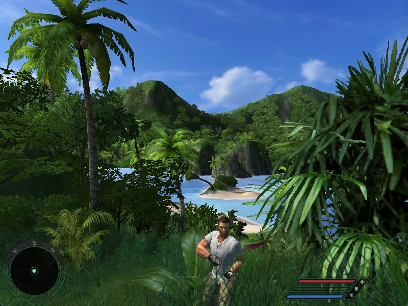
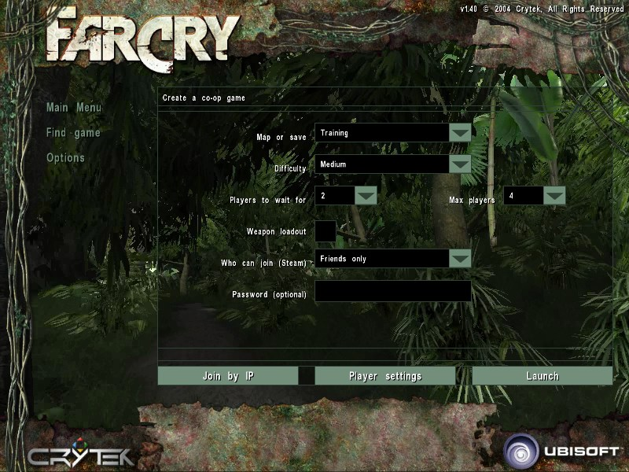
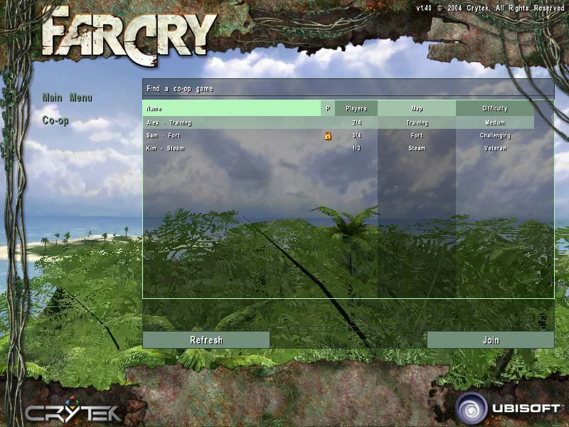

# FC1 Co-op

**EN** · [RU](#русский)

Campaign co-op for Far Cry 1 (2004) in the spirit of Sven Co-op and Synergy: the original 20 levels, together with friends over the network, looking like vanilla.

> **Status: work in progress, nothing for players yet.** The first release comes when the first chapter is fully playable by two.

| Two players in the campaign (Fort) | Co-op menu | Find game |
|---|---|---|
|  |  |  |

<sub>Find game shows example rows; the real list comes from Steam.</sub>

## Base and credits

- A fork of [FarCryCoop](https://github.com/Bantila/FarCryCoop) by Bantila (MIT): a Lua pack (game type `COOP`) plus an ASI plugin hooking `CryGame.dll` 1.4, plus a launcher. Its code is in `games/far-cry/`, its research log in [games/far-cry/NOTES.md](games/far-cry/NOTES.md), the base's install and console notes in the [upstream README](https://github.com/Bantila/FarCryCoop#readme).
- Contest Island: Invasion (Mixer, Garcy, Garbitos): studied as an example of a Lua co-op mod.
- Method: the [coop-anything](https://github.com/cranebeaker/coop-anything) playbook.

## What is ours

- **Test harness** (`tools/harness`, Go): starts a listen server and N clients on one PC, drives them through an in-game Lua agent (`scripts/harness/agent.lua`), diffs the server's and clients' entity snapshots (desync detector), catches crashes, error dialogs and hangs, takes minidumps and screenshots. Scenarios are in `tests/`.
- **Fixes to the base** (in `main`): helicopters sync at once and finish their setup on the client, the map intro waits for all players, weapons dropped by AI appear at the body, level pickups do not fall through the floor in MP, the loadout carries over between maps as in single player and is kept per player (reconnects, saves).
- **In-game menu instead of the launcher:** Main menu → Co-op (map or save, difficulty, players to wait for, player limit, who can join, password, server name), Find game (a server browser: Internet, Friends and LAN tabs, ping, filters by map, difficulty, free slots and password), Player settings. The name is the Steam name; friends join through Steam with no port forwarding.
- **Install is one folder:** `FarCryCoop` dropped into the game's `Mods` folder, started with `-MOD:FarCryCoop`; the mod's own `CryGame.dll` loads the game's and hooks it, nothing goes into the game's `Bin32`. A test build is packed after every push to `main` (`.github/workflows/package.yml`, [TEST-BUILD.md](games/far-cry/release/TEST-BUILD.md)).
- Logs, in Russian: [docs/findings.md](docs/findings.md) (findings and measurements), [docs/maps.md](docs/maps.md) (status of the 20 maps), [docs/changelog.md](docs/changelog.md) (session log).

## Running the tests

Needs: Far Cry 1.4 from Steam (Steam running), Go, MSVC 2019 Build Tools (x86).

```
tools\fcc\build-asi.cmd
cd tools && set GOARCH=386 && go build -o bin/harness.exe ./harness && cd ..
tools\bin\harness.exe test tests\training-basic.txt
```

Details: [tools/harness/README.md](tools/harness/README.md).

## License

FarCryCoop's code is [MIT](LICENSE). The license of our own code will be chosen before the first release. Code based on the Mod SDK 1.4 is distributed only for free, under the SDK license. `steam_api.dll` is Valve's Steamworks redistributable. Far Cry is a trademark of Crytek / Ubisoft; this is a fan project, not affiliated with them. You need your own copy of the game.

---

## Русский

Кооп кампании Far Cry 1 (2004) в духе Sven Co-op и Synergy: оригинальные 20 карт, вместе с друзьями по сети, внешне как ванила.

> **Статус: в разработке, для игроков пока ничего нет.** Первый релиз — когда первая глава будет полностью проходима вдвоём.

Скриншоты — в начале страницы: двое на карте кампании (Fort), экран Co-op, Find game (строки списка там для примера).

### Основа и благодарности

- Проект — форк [FarCryCoop](https://github.com/Bantila/FarCryCoop) (Bantila, MIT): Lua-пак (game type `COOP`) + ASI-плагин с хуками `CryGame.dll` 1.4 + лаунчер. Их код лежит в `games/far-cry/`, их технический журнал — [games/far-cry/NOTES.md](games/far-cry/NOTES.md), инструкции по установке и консоли базы — в [README апстрима](https://github.com/Bantila/FarCryCoop#readme).
- Contest Island: Invasion (Mixer, Garcy, Garbitos) — изучен как пример кооп-мода на Lua.
- Метод — плейбук [coop-anything](https://github.com/cranebeaker/coop-anything).

### Что здесь своего

- **Харнес** (`tools/harness`, Go): запускает listen-сервер и N клиентов на одном ПК, управляет ими через Lua-агента в игре (`scripts/harness/agent.lua`), сравнивает снапшоты сущностей сервера и клиентов (детектор десинка), ловит крэши, диалоги ошибок и зависания, снимает минидампы и скриншоты. Сценарии-тесты в `tests/`.
- **Фиксы базы** (в `main`): вертолёты синхронизируются сразу и доинициализируются у клиента, интро карты ждёт всех игроков, выпавшее у ИИ оружие появляется у трупа, пикапы уровня не проваливаются в MP, снаряжение переносится между картами как в одиночной игре и хранится по ключу игрока (переподключение, сейвы).
- **Меню в игре вместо лаунчера:** главное меню → Co-op (карта или сохранение, сложность, сколько ждать игроков, лимит, кто может войти, пароль, имя сервера), Find game (браузер серверов: вкладки Internet, Friends и LAN, пинг, фильтры по карте, сложности, свободным местам и паролю), Player settings. Ник — имя Steam; друзья заходят через Steam, без проброса портов.
- **Установка — одна папка:** `FarCryCoop` в папку `Mods` игры, запуск с `-MOD:FarCryCoop`; своя `CryGame.dll` мода подгружает игровую и ставит хуки, в `Bin32` игры ничего не кладётся. Тестовая сборка собирается после каждого пуша в `main` (`.github/workflows/package.yml`, [TEST-BUILD.ru.md](games/far-cry/release/TEST-BUILD.ru.md)).
- Журналы: [docs/findings.md](docs/findings.md) (находки и замеры), [docs/maps.md](docs/maps.md) (статус 20 карт), [docs/changelog.md](docs/changelog.md) (журнал сессий).

### Как прогнать тесты

Нужны: Far Cry 1.4 из Steam (Steam запущен), Go, MSVC 2019 Build Tools (x86). Команды — те же, что выше; подробности — [tools/harness/README.md](tools/harness/README.md).

### Лицензия

Код FarCryCoop — [MIT](LICENSE). Лицензия на наш код будет выбрана до первого релиза. Код на базе Mod SDK 1.4 распространяется только бесплатно, по лицензии SDK. `steam_api.dll` — редистрибутив Steamworks от Valve. Far Cry — торговая марка Crytek / Ubisoft; это фанатский проект, не связанный с ними. Нужна своя копия игры.
